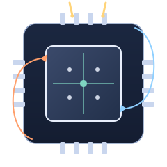

# Introduction to IC Testing Follow one chip through four exams, from wafer to shipment

🌐 **English** ｜ [简体中文](README.md)

📖 **Start reading** → [Table of contents](zh-CN/README.en.md)　｜　🗂 **Deep notes** → [notes/](notes/)　｜　🤖 **Install as an AI skill** → [INSTALL.md](INSTALL.md)

---

An open textbook for the course **"IC Testing"**.

Whether a chip works cannot be judged by looking at it — you have to ask it with electricity. The machine that asks is the **Automatic Test Equipment** (ATE). This book follows one chip from the moment it is still on the wafer, through wafer probe, packaging and final test, all the way to being binned as good and shipped. Along the way it opens up the tester, shows what is inside, what each class of test item actually measures, how a test program is written, and how the data is read.

No heavy math. The focus is on three things: **flow** (the order in which a test runs), **terminology** (Chinese/English pairs and how people actually say it on the test floor), and **know-how** (things textbooks don't say but that you hit on your first day at the machine).

**Who it is for**: undergraduates and graduate students in electronics, microelectronics and automation; new engineers starting on the test floor; designers and process engineers who want to know what their chip goes through on a tester. A basic understanding of circuits is enough — no semiconductor physics background required.

> **Note on languages**: the full 28-chapter text is currently written in Simplified Chinese. This English edition covers the overview, the complete table of contents with per-chapter summaries, and the skill entry point. Chapters are being translated incrementally — contributions are welcome.

---

## What's in this repository

This repository is three things at once, all fed from the same source:

| Entry | What it is | Where |
|---|---|---|
| 📖 **A book** | 28 chapters organized as "follow one chip", each 6–9 KB, with terminology boxes and know-how boxes | [zh-CN/README.en.md](zh-CN/README.en.md) (English TOC) / [zh-CN/README.md](zh-CN/README.md) (full text) |
| 🗂 **A set of notes** | 28 dense raw notes — slide transcriptions, API manual excerpts, line-by-line analysis of six complete projects, ~870 KB | [notes/](notes/) |
| 🤖 **An AI skill** | `SKILL.md` + all notes, following the Agent Skills convention; install it into a compatible tool and query it directly | [INSTALL.md](INSTALL.md) |

**The book is the door; the notes are the material.** Details mentioned at the end of each chapter — the full signature of an API, a line-by-line project analysis, an excerpt from a datasheet — all live in `notes/`, organized by the position of the original material. Just follow the links.

---

## A taste: what is an SMU?

> This is the most representative single topic in the repository. Full version in [Chapter 7 — SMU](zh-CN/2-instrumentation/07-smu/README.md) (Chinese).

**SMU = Source Measure Unit.** The acronym has two layers of meaning:

**① General meaning**: an instrument channel that combines a **precision source** (force voltage or current) and a **precision meter** (measure voltage or current). Its defining capability is **four-quadrant operation** — it can act as a power supply, as a load, and sweep in both directions.

**② On this platform**: one class of board in the `.sig` file, `AFEType = SMU`, model **SMU20**.

| Item | Specification |
|---|---|
| Voltage | **Four ranges: 1 V / 5 V / 10 V / 20 V** (highest on the platform, hence "high-voltage power module" in the manual) |
| Current | **±500 mA**; up to **2 A** when gang-paralleled |
| Voltage accuracy | **±(0.05% + 0.5 mV) to ±(0.05% + 10 mV)** (best on the platform) |
| Current ranges | **7 ranges: 1 µA / 10 µA / 100 µA / 1 mA / 10 mA / 100 mA / 500 mA** |
| Variants | `SMU`, `SMU_GANG2/3/4` |

**The key point**: a DPS can only force voltage (no `FIMV` / `FIMI`, it cannot source current), while an SMU supports all seven measurement modes and is the **only resource on the platform that supports the `FVMIMV` / `FIMVMI` hybrid modes and both clamp types** — which is why it is called a Source **Measure** Unit rather than a power supply.

---

## Book structure

| Part | Topic | Chapters |
|---|---|---|
| Part 0 | Before you start: journey map and the test floor | 0–1 |
| Part 1 | Fundamentals: what is tested, what is judged, how it connects | 2–3 |
| Part 2 | Tester resources: PE, DPS, PMU, SMU, others | 4–8 |
| Part 3 | DC parametric tests: leakage, output drive, supply current, analog parameters | 9–12 |
| Part 4 | Digital and functional tests: patterns, timing, AC parameters | 13–15 |
| Part 5 | Writing test programs: the seven files, Test.cpp, measurement modes, debugging | 16–19 |
| Part 6 | Six hands-on case studies: from a decoder to an ADC | 20–25 |
| Part 7 | Beyond the bench: yield, data, production line | 26–27 |
| Appendix | Glossary, pitfall checklist, further reading | A–C |

Full chapter list, reading paths and per-chapter summaries: **[zh-CN/README.en.md](zh-CN/README.en.md)**.

---

## Writing conventions

Every chapter has the same three companions:

| Marker | Content |
|---|---|
| 📍 Journey position | Where this chapter sits in the journey, and what comes before/after |
| 📖 Terminology box | Definition, how people say it on the floor, related terms, and the most common confusion |
| 🔧 Know-how box | How to do it on site, and "why this way, what happens if you don't" |

The body text is in Simplified Chinese; on first occurrence a term is written as "中文（English, abbreviation）". Full wording, formatting and linking rules are in [STYLE_GUIDE.md](STYLE_GUIDE.md).

---

## Contributing

- **Found an error**: open an [Issue](https://github.com/wuyu25394-alt/sziit-speedcury-st2500-ate-skill/issues) with the chapter and the original text.
- **Want to add content**: read the [style guide](STYLE_GUIDE.md) and [contribution guide](CONTRIBUTING.md) first.
- **Missing things**: figures, exercises, and more device case studies are all still needed — English translations of chapters are especially welcome.

If this book is useful to you, a ⭐ in the top-right corner is enough.

---

## Sources and disclaimer

This repository is a re-organization and rewrite of the **"IC Testing" course materials** from AccelTest / Xinxing Plan (24 PDF slide decks, 1 API programming manual, 1 DOCX, 6 complete ATE projects). Copyright of the original materials belongs to their respective owners. This book is for study and research only, **not for commercial use**.

- Model names (ST2500, ST2516, SMU20, DFB32, etc.) are used for illustration only; refer to the latest official documentation for specifications.
- Limit windows, delays and similar numbers vary with product and process; numbers in the book are examples only.
- Where the original materials **contradict themselves or contain obvious typos** (slide limits disagreeing with a project's `.tmf`, a pin table disagreeing with the body text, an 8-bit ADC's ENOB written as 12–16 bit, real bugs in project source code), they are recorded faithfully and left unmodified in **[KNOWN-ISSUES.md](KNOWN-ISSUES.md)**.
- If you need content removed, please open an Issue and it will be handled promptly.

See [NOTICE.md](NOTICE.md) for details.

## License

The text is licensed under [Creative Commons Attribution-NonCommercial-ShareAlike 4.0 International](LICENSE) (CC BY-NC-SA 4.0). You may freely copy, adapt and translate it as long as you attribute the source, do not use it commercially, and share under the same license.
