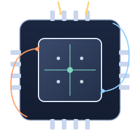

# 集成电路测试入门 Introduction to IC Testing

**跟着一颗芯片，走完从晶圆到出厂的四次考试**

📖 **开始读** → [全书目录](zh-CN/README.md)　｜　🗂 **深度笔记** → [notes/](notes/)　｜　🤖 **装成 AI 技能** → [INSTALL.md](INSTALL.md)

---

一本写给**「集成电路测试」这门课**的开放教材。

一颗芯片做出来到底能不能用，不能靠看，只能靠电去问。问它的那台机器叫**自动测试设备**（ATE）。这本书跟着一颗芯片，从晶圆还在片子上开始，经过中测、封装、成测，一路到它被判定合格、装箱出货——中间把那台机器拆开，看里面有什么、每一类测试项在测什么、程序怎么写、数据怎么读。

不推公式，专注三件事：**流程**（一次测试按什么顺序走）、**名词**（中英对照与现场说法）、**Know-how**（教科书不写、上机第一天就会撞上的事）。

**适合谁读**：电子/微电子/自动化专业的本科生与研究生；刚进测试岗的新人；想了解自己的芯片在测试机上经历了什么的设计与工艺工程师。懂一点电路就够，不需要半导体物理基础。

---

## 仓库里有什么

这个仓库同时是三样东西，三条入口都从同一份内容出发：

| 入口 | 是什么 | 从哪进 |
|---|---|---|
| 📖 **一本书** | 28 章正文，按「跟着一颗芯片走」的顺序组织，每章 6～9 KB，配名词框与 Know-how 框 | [zh-CN/README.md](zh-CN/README.md) |
| 🗂 **一套笔记** | 27 篇高密度原始笔记，课件图表转录、API 手册摘录、六个工程逐行分析，约 85 万字节 | [notes/](notes/) |
| 🤖 **一个 AI 技能** | `SKILL.md` + 全部笔记，符合 Agent Skills 约定，装进支持它的工具后可直接检索 | [INSTALL.md](INSTALL.md) |

**书是入口，笔记是资料。** 每一章结尾提到的细节——某个 API 的完整签名、某个工程的逐行分析、某款芯片数据手册的摘录——都在 `notes/` 里，顺着链接走过去就行。

---

## 全书结构

| 部 | 主题 | 章 |
|---|---|---|
| 第 0 部 | 开始之前：旅程地图与测试车间 | 0～1 |
| 第 1 部 | 基础：测什么、判什么、怎么串起来 | 2～3 |
| 第 2 部 | 测试机的资源：PE、DPS、PMU、SMU、其他 | 4～8 |
| 第 3 部 | 直流参数测试：漏电、输出、电源电流、模拟参数 | 9～12 |
| 第 4 部 | 数字与功能测试：Pattern、时序、交流参数 | 13～15 |
| 第 5 部 | 写测试程序：七种文件、Test.cpp、测量模式、排错 | 16～19 |
| 第 6 部 | 六个实训案例：从译码器到 ADC | 20～25 |
| 第 7 部 | 走出实训台：良率、数据、量产线 | 26～27 |
| 附录 | 术语总表、踩坑清单、延伸阅读 | A～C |

完整目录、阅读路线与每章摘要见 **[zh-CN/README.md](zh-CN/README.md)**。

---

## 写作约定

每一章都有三个固定的小帮手：

| 标示 | 内容 |
|---|---|
| 📍 测试旅程位置 | 这一章在整趟旅程的哪一站，前一站和下一站是什么 |
| 📖 名词框 | 定义、现场说法、相关名词，以及最容易搞混的地方 |
| 🔧 Know-how 框 | 现场怎么做，以及「为什么要这样做、没做会怎样」 |

全书用简体中文，术语首次出现写成「中文（English，缩写）」。完整的用词、排版与链接规则见 [STYLE_GUIDE.md](STYLE_GUIDE.md)。

---

## 参与

- **发现错误**：开一条 [Issue](https://github.com/wuyu25394-alt/ic-testing-notes-groupA/issues)，写清章节与原文。
- **补充内容**：先读 [写作规范](STYLE_GUIDE.md) 与 [贡献指南](CONTRIBUTING.md)。
- **缺什么**：图、练习题、更多器件案例都还缺，欢迎补。

如果这本书对你有用，点一下右上角的 ⭐ 就行。

---

## 素材来源与免责

本仓库是对**加速科技 / 芯星计划「集成电路测试」课程资源**的整理、改写与再组织（24 份 PDF 课件、1 份 API 编程手册、1 份 DOCX、6 个完整 ATE 工程）。原始资料著作权归各权利人所有，本书仅作学习与研究用途，**不用于商业目的**。

- 书中涉及的型号（ST2500、ST2516、SMU20、DFB32 等）仅用于说明，规格数值以官方最新文档为准。
- 判据窗口、延时等具体数值随产品与工艺而变，书中的数字只作示例。
- 如需删除相关内容，请开 Issue 联系，会尽快处理。

详见 [NOTICE.md](NOTICE.md)。

## 授权

本书文字采用 [知识共享 署名—非商业性使用—相同方式共享 4.0 国际](LICENSE)（CC BY-NC-SA 4.0）授权。注明出处、不用于商业目的、以相同方式分享，即可自由转载、改编与翻译。
