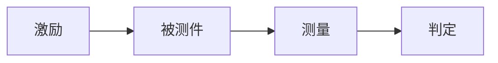

# 第 N 章　主题：副标题

> 📍 **测试旅程位置**
>
> - 前一站：上一章讲到哪里
> - **本章：这一章要解决什么问题**
> - 下一站：下一章要往哪走

---

## 第一节：为什么要关心这件事

用两三段把问题摆出来。可以是一个现场现象、一个常见误解、一个必须回答的问题。

> [!NOTE]
> **📖 名词｜中文（English，缩写）**
>
> - **定义**：一句话说明它是啥。
> - **现场用法**：「……」——车间里的原话。
> - **相关名词**：甲、乙、丙
> - **常见混淆**：和某某最容易搞混，差别在哪。

---

## 第二节：原理

讲清楚它为什么能工作。可以配一张表或一段 Mermaid 流程图。

---

## 第三节：具体怎么做

给步骤、给条件、给判据。数字要在笔记库里有出处。

**上电 → 复位 → 写配置 → 读回 → 判定**

1. 第一步……
2. 第二步……

> [!TIP]
> **🔧 Know-how｜一句话点出重点**
>
> - **情境**：什么情况下会遇到。
> - **做法**：现场怎么做。
> - **为什么**：背后的原因。
> - **没做会怎样**：后果是什么。
> - **相关章节**：[第 N 章 标题](相对路径)

---

## 第四节：常见异常

| 异常 | 可能原因 | 结果 |
|---|---|---|
| …… | …… | …… |
| …… | …… | …… |

---

## 本章重点

1. ……
2. ……
3. ……
4. ……

---

## 延伸阅读

- 课程资料：《……》
- 教材：……
- 笔记库：[……](../../../notes/)

---

[← 上一章：第 N-1 章 标题](../<上一章目录>/README.md) ｜ [目录](../../README.md) ｜ [下一章：第 N+1 章 标题 →](../<下一章目录>/README.md)
