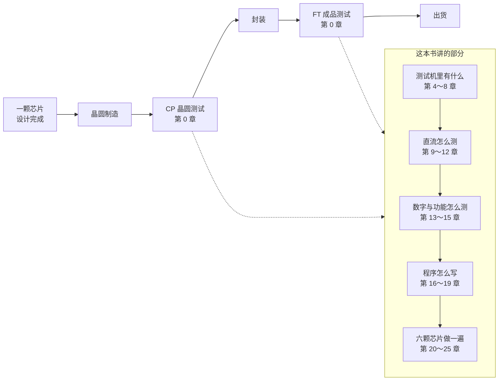

# 第 0 章　ATE 全景：一颗芯片要过几道考场

> 📍 **测试旅程位置**
>
> - 前一站：晶圆制造完成，芯片还在一片晶圆上，没有被切开
> - **本章：先看整趟旅程的地图——芯片一共要考几次，谁在考它**
> - 下一站：走进测试车间，看那台「考官」由什么组成

---

## 芯片出厂前，要考两次

一颗芯片从设计图纸到装进手机，中间有两次真正意义上的「考试」。

第一次发生在晶圆还没被切开的时候。整片晶圆被送到一台机器上，探针一根一根扎到每一颗裸片的焊盘上，逐颗测一遍。这一次叫**晶圆测试**，也叫中测、**CP**。

第二次发生在封装之后。芯片已经被切成一颗一颗、焊上引脚、装进黑色的小壳子里，再被送进另一台机器，插到插座里测。这一次叫**成品测试**，也叫成测、**FT**。

两次测的都是同一件事——**这颗芯片的电学行为，和设计者写在数据手册里的要求，对不对得上**。区别只在被测的对象：一次是裸片，一次是成品。

> [!NOTE]
> **📖 名词｜自动测试设备（Automatic Test Equipment，ATE）**
>
> - **定义**：能自动施加激励、自动测量响应、自动判定合格与否的测试系统，国内习惯直接叫「测试机」。
> - **现场用法**：「这批片子 ATE 上跑一遍，看 bin 分布。」
> - **相关名词**：DUT、Prober、Handler、Test Program
> - **常见混淆**：把 ATE 等同于「一台仪器」。它是一整套系统：测试机本体、外围设备、接口板、测试程序，缺一样都跑不起来。

---

## 测试到底在证明什么

很多人的第一反应是：测试就是「把坏的挑出来」。这话只对了三分之一。

**第一件事，是挑出坏的。** 制造过程有随机性，一片晶圆上总有几颗是坏的。测试把它们标出来，不让它们流到客户手里。这件事的价值很直接：一颗坏芯片装进整机，代价是整机返修。

**第二件事，是验证设计。** 新芯片第一次流片回来，谁也不知道它到底能不能工作。第一次上测试机，本质是一次验证：设计者说的那些参数，做出来的硅片上是不是真的成立。这一轮测试常常反过头去改设计、改数据手册。

**第三件事，是反馈工艺。** 如果某条产线这一批的漏电流普遍偏高，或者某个 bin 的比例突然涨了，测试数据就是最早的信号。**测试是制造的眼睛**——它不生产芯片，但它告诉你生产得好不好。

> [!TIP]
> **🔧 Know-how｜测试项不是越多越好**
>
> - **情境**：刚接手一个产品，数据手册上的参数有几十条，看起来每条都该测。
> - **做法**：先按「这项测出来不合格，客户会不会真的用不了」筛一遍，再按「这项能不能间接反映别的项」合并，剩下的才进测试流程。
> - **为什么**：每加一项就多一段时间。测试设备是按小时算钱的，测试时间直接换算成每颗芯片的成本。
> - **没做会怎样**：测试项堆到几百条，单颗测试时间从 1 秒涨到 5 秒，这条产线的产能直接掉到五分之一。
> - **相关章节**：[第 3 章 一次测试的骨架](../../1-fundamentals/03-test-flow-and-bin/README.md)

---

## 三台设备，一台机也少不了

测试车间里干活的是三台设备，分工非常清楚：

| 设备 | 职责 | 用在哪 |
|---|---|---|
| **测试机**（Tester） | 等外围设备说「准备好了」，执行测试，把结果返回 | CP 和 FT 都用 |
| **探针台**（Prober） | 把晶圆移到针卡下面，报告哪几颗可以测、坐标是多少，测完给失效品打墨点 | CP |
| **分选机**（Handler） | 把封装好的芯片自动送进插座、按结果分等级装进不同的料管 | FT |

所以「测试」这个动作的真实节奏是：**分选机/探针台先动，动到位了通知测试机，测试机测完把结果交回去，外围设备再动。** 测试机大部分时间在等，等的就是外围设备那声「就绪」。

理解了这一点，就理解了很多现场现象：为什么测试程序的第一个动作往往是等一个信号，为什么测同样的东西，换一台分选机产能就变了。

> [!NOTE]
> **📖 名词｜被测器件（Device Under Test，DUT）**
>
> - **定义**：当前正在被测试的那一颗芯片，也叫「被测件」。
> - **现场用法**：「这个 socket 的 DUT 位置 3 一直 fail，换个座子试试。」
> - **相关名词**：Site、Socket、DIB、PIB
> - **常见混淆**：把 DUT 和「产品型号」混为一谈。DUT 指的是**这一次**被夹在夹具里的那一个实物。

---

## 一台机器，两种接口板

CP 和 FT 用的测试机是同一台，但接出来的东西不一样，因为被测对象的形状不一样。

| | CP | FT |
|---|---|---|
| 被测对象 | 晶圆上的裸片 | 封装好的芯片 |
| 怎么接触 | 探针卡（Probe Card）扎焊盘 | 插座（Socket）夹引脚 |
| 中间那块板 | **PIB**（探针接口板） | **DIB**（负载板，Load Board） |
| 外围设备 | 探针台 | 分选机 |

接口板是这本书里会反复出现的东西：它把测试机标准化的通道，翻译成这颗芯片具体的引脚。**换一个产品，通常就是换一块接口板加一份测试程序。**

---

## 测试程序是怎么被写出来的

测试工程师的日常，大致是这样一条链：

**读数据手册 → 定测试计划 → 写测试程序 → 上机调试 → 相关性比对 → 导入量产**

每一步都有对应的文档：

| 文档 | 谁写 | 里面是什么 |
|---|---|---|
| **数据手册**（Datasheet） | 芯片厂商 | 参数的名义值、最小值、最大值、测试条件 |
| **测试计划**（Test Plan） | 设计、测试、产品工程师协作 | 测哪些项、什么条件测、判据是多少、什么顺序 |
| **测试程序**（Test Program） | 测试工程师 | 把测试计划翻译成机器能执行的流程与代码 |

数据手册给的是「设计意图」，测试计划给的是「怎么验证这个意图」，测试程序给的是「机器实际怎么做」。**三者之间经常打架**：手册写的测试条件和实际能实现的条件不一致，判据的窗口在量产良率面前太紧。这时候要回头改的不是程序，往往是计划，甚至是手册。

> [!TIP]
> **🔧 Know-how｜先跑通，再谈准**
>
> - **情境**：新程序第一次上机，一堆测试项报错或者读数离谱。
> - **做法**：先把所有判据放到最松（几乎不可能 fail），确认「能测到数、数在合理量级」，再一项一项收紧判据。
> - **为什么**：一次改十个地方，出错时分不清是判据的问题还是接线、量程、时序的问题。
> - **没做会怎样**：判据和硬件问题混在一起查，一天也定位不到根因。
> - **相关章节**：[第 19 章 调试与排错](../../5-programming/19-debugging/README.md)

---

## 这本书怎么走

第 1 部讲清楚「测什么、判什么」，第 2 部拆开测试机看里面的资源，第 3、4 部分别讲直流和数字两类测试方法，第 5 部讲怎么把它写成程序，第 6 部拿六颗真芯片从头做一遍，第 7 部走出实训台看量产。

---

## 谁在干这些活

测试不是一个岗位，是一串岗位：

| 岗位 | 关心什么 |
|---|---|
| **测试工程师** | 测试方案、程序编写与调试、导入量产 |
| **产品工程师** | 产品本身、新产品导入、**限值（Limit）设定**、失效分析 |
| **应用工程师** | 测试系统的应用支持、方案开发、客户培训 |
| **维护工程师** | 机器保养、校准、日常故障 |
| **现场服务工程师** | 设备厂商的人，装机、修硬件、培训维护 |

有意思的是「限值设定」这一项挂在产品工程师名下，而不是测试工程师。**写程序的人和定判据的人是两个人**，这个分工背后是一条基本原则：判据来自产品的要求，不来自测试的方便。

---

## 本章重点

1. 芯片出厂前要考两次：晶圆阶段的 **CP**，封装之后的 **FT**。
2. 测试做三件事：挑出坏品、验证设计、反馈工艺。只把测试当「筛选」会低估它。
3. 测试车间三台设备分工明确：测试机执行，探针台/分选机负责搬运与就绪通知。
4. CP 用探针卡加 PIB，FT 用插座加 DIB——换产品通常就是换一块接口板加一份程序。
5. 数据手册、测试计划、测试程序是三份不同的东西，三者打架是常态，改哪一份要看问题出在哪一层。

---

## 延伸阅读

- Michael L. Bushnell、Vishwani D. Agrawal，《Essentials of Electronic Testing for Digital, Memory and Mixed-Signal VLSI Circuits》
- 加速科技培训课件《集成电路测试基础》（产业链、测试流程与岗位分工）
- SEMI 标准中关于测试数据格式（STDF）的部分，可以看到量产里测试结果长什么样

---

[← 上一章：无](../../README.md) ｜ [目录](../../README.md) ｜ [下一章：第 1 章 走进测试车间 →](../01-test-floor/README.md)
