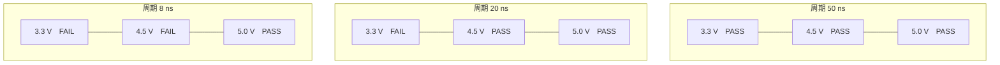

# 第 15 章　交流参数：传输延时、边沿与 Shmoo

> 📍 **测试旅程位置**
>
> - 前一站：时序是配置项，是我们给芯片的
> - **本章：时序变成测量对象，是我们向芯片要的**
> - 下一站：第 5 部开始写程序

---

## 交流参数测什么

第 14 章的 Timing 是我们给芯片的配置：周期定 10 µs、采样点放 9 µs，芯片照做。这一章反过来：手册写着 tPD 典型 14 ns、最大 22 ns，这个 22 ns 不是设的，是要向芯片问的。分水岭就在「时序归谁」上：一个问「按这个时序跑，逻辑对不对」，一个问「芯片自己有多快」。四族参数都能量，也都带测点约定：

| 参数 | 定义 | 测点约定 | 74LS194（25 °C、5.0 V、CL = 15 pF） |
|---|---|---|---|
| tPLH | 输出由低到高的延时 | 输入、输出都取幅度 50% 点 | 14 / 22 ns |
| tPHL | 输出由高到低的延时 | 同上 | 17 / 26 ns |
| tPD | 传输延时 | tPLH 与 tPHL 取算术平均 | 由上面两行算出 |
| tR / tF | 上升 / 下降时间 | 10%～90% | 手册未单列 |
| tSU | 建立时间 | 时钟有效沿之前数据稳定的时长 | 数据 20 ns、模式控制 30 ns |
| tH | 保持时间 | 时钟有效沿之后数据仍需保持的时长 | 0 ns |
| fMAX | 最高工作频率 | 输出仍然正确的最高时钟频率 | 10 MHz |

延时取 50% 点，是因为边沿有斜率、起止点不好定，中点最稳；tR/tF 取 10%～90%，跳过头尾两段圆角。「14 / 22」是典型与最大，不是两个参数。

频率那类参数走另一条路：HK32F031F4P6 的 HSI 8 MHz（±2%）、LSI 20～40 kHz、PLL 20 MHz 都用 TMU 测。TMU 靠 DIO 资源复用，通道 0～3 默认对应 DIO 0、1、16、17。

> [!NOTE]
> **📖 名词｜传输延时（Propagation Delay，tPD）**
>
> - **定义**：输入跳变到输出跟着跳变之间的时间，取两边波形的 50% 幅度点计算；上升、下降两个方向分别记 tPLH、tPHL，再取平均。
> - **现场用法**：「这颗片子 tPD 最大 22 ns，采样点放到 30 ns 就行。」
> - **相关名词**：tPLH、tPHL、上升时间、fMAX
> - **常见混淆**：和建立时间混。tPD 是输入到输出，tSU 是数据到时钟，量的是两件事。

---

## 怎么测：扫一个轴，找那个点

交流参数读不出来，只能逼：把条件一步步推向极限，直到输出出错，前一步就是边界。

1. **扫采样点**（固定频率、动时间）：周期不动，把比较沿从晚往早挪，每挪一步跑一次 Pattern。挪到开始 fail，前一步的时刻就是 tPD，加上线缆与接口板的延时。
2. **扫频率**（固定采样点、动周期）：从慢往快收周期直到 fail；最后通过的周期换算出 fMAX。

**定条件 → 设起点 → 步进或二分 → 记边界 → 换条件复测**

周期范围 8 ns～256 µs 跨四个数量级以上，线性步进太慢：先粗扫定位，再在边界附近二分，几步就收到 1 ns 的时基上。单点测试只回答过或不过，扫描才给数值——这是本章和上一章最本质的差别。

> [!TIP]
> **🔧 Know-how｜扫出来的边界要复测**
>
> - **情境**：扫到边界，比如 24 ns 过、23 ns 不过。
> - **做法**：在边界附近来回各跑 5～10 次，看结论稳不稳；不稳就往外让一格，别硬用。
> - **为什么**：边界处的结论对噪声、温度、探头位置都敏感，单次不可靠。
> - **没做会怎样**：把偶然的 pass 当边界写进限值，量产时同一批片子一半判 fail。
> - **相关章节**：[第 26 章 良率与数据](../../7-beyond-the-bench/26-yield-and-data/README.md)

---

## Shmoo 图：把一次扫描摊成一张图

Shmoo 是二维扫描：横轴一个条件，纵轴一个条件，一格一个 pass/fail。图上从上到下周期缩短，从左到右电压升高：

PASS 的格子集中在右上角，FAIL 的落在左下：周期越短、电压越低，两头一起吃亏。一个数只说「过」或「不过」，一张图说三件事：**余量**（离边界还有几格）、**形状**（斜着退，还是一下子塌）、**方向**（电压先撑不住，还是时间先撑不住）。斜边界说明电压和时间在互相补偿——电压高一点就能跑快一点；竖直边界说明时间不是瓶颈；水平边界说明电压不是瓶颈。三种形状指向的根因不同，比对着几个数字争论，摊开图更有用。

> [!NOTE]
> **📖 名词｜Shmoo 图**
>
> - **定义**：把两个测试条件做成横纵轴，逐格跑 pass/fail 画出来，用来找参数边界的图。
> - **现场用法**：「拉一张电压 × 周期的 Shmoo，看边界是不是斜的。」
> - **相关名词**：边界扫描、余量（Margin）、fMAX
> - **常见混淆**：和一张结果表混。表是离散记录，Shmoo 是把整个网格摊开，边界一眼可见。

---

## 边沿与负载：探头也会骗你

边沿不是芯片一个人的事：从 DIO 通道到引脚，中间有继电器、接口板、线缆、探头，每段都带电容和电感。

- 接口板和线缆的电容把边沿拉缓：负载从 15 pF 加到几十 pF，边沿就明显变缓。
- DIO 的输出阻抗是 50 Ω ±10%，线没接成 50 Ω 就会反射，波形上出现过冲和振铃——课件把这类波形列为与理想波形差别较大的一类。
- 探头自己有电容，探上去波形就变了；拿它量几纳秒的边沿，量到的往往是探头自己的。

手册的交流参数一定带着测试条件（74LS194 那栏是 CL = 15 pF）。要和手册比，先确认负载条件对得上，对不上的部分不是芯片的。边沿变缓的后果是采样点要往后推，推出来的「延时」就偏大——测出偏慢，先怀疑负载，再怀疑芯片。

> [!TIP]
> **🔧 Know-how｜先量一遍空载波形**
>
> - **情境**：第一次给一块新接口板做交流测试。
> - **做法**：不插 DUT，先让 DIO 空跑一段 Pattern，用示波器看驱动波形；插上一颗 DUT 再重复一次。
> - **为什么**：两次的差别就是接口板与 DUT 的负载效应，它是后面所有测量的本底。
> - **没做会怎样**：把接口板带来的几纳秒延时算进芯片的 tPD，整批片子判偏慢，其实是板子的问题。
> - **相关章节**：[第 4 章 Pin Electronics](../../2-instrumentation/04-pin-electronics/README.md)

---

## 与功能测试的分工

功能测试快、覆盖广、每颗都跑；交流参数测试慢、只出数值，通常只在首件、抽检、换批次、换温度、换接口板时做。

两者共用同一套 Pattern、Timing、PinLevel，差别只在跑法：一个照配置跑，一个边跑边改配置。交流测试不必另建工程，只要在功能测试的工程上多做一层扫描。

> [!TIP]
> **🔧 Know-how｜别把 AC 项排进每一颗**
>
> - **情境**：新器件的 AC 表有十几项，看着每项都该测。
> - **做法**：先看它在整机里是不是时序关键件：接时钟、总线、做分频的要抽测；纯静态逻辑交给功能测试即可。
> - **为什么**：AC 一次扫描要跑几十个点，每个点都是一整段 Pattern，时间远比一次功能测试长。
> - **没做会怎样**：把扫描排进每颗的流程，产能被吃掉一大截，还未必多筛出坏品。
> - **相关章节**：[第 13 章 功能测试](../13-functional-test/README.md)

---

## 本章重点

1. 交流参数测的是芯片自己的时间：tPD、tR/tF、tSU/tH、fMAX，判据是手册的 min / max，不是我们设的时序。
2. 延时取 50% 点、tPLH 与 tPHL 取平均，上升下降时间取 10%～90%——测点约定不统一，数字就没法比。
3. 测法只有一种思路：把条件推向极限找边界。固定频率扫采样点得延时，固定采样点扫周期得 fMAX。
4. Shmoo 图把扫描摊成二维网格，余量、边界形状、失效方向一眼可见，比单个数字信息量大。
5. 边沿受负载影响：接口板、线缆、探头都能把边沿拉缓，测出来偏慢时先查负载，再查芯片。

---

## 延伸阅读

- 加速科技培训课件《集成电路基础测试原理》AC 部分（延时、建立保持、上升下降时间的定义与测点）
- 74LS194 数据手册的交流参数表（25 °C、5.0 V、CL = 15 pF 条件下的时延与频率）
- 《ST2500 系列使用手册》TMU 与 DIO 资源复用说明（通道 0～3 与 DIO 0、1、16、17 的对应）

---

[← 上一章：第 14 章 时序与电平：Timing、PinLevel 与波形](../14-timing-and-levels/README.md) ｜ [目录](../../README.md) ｜ [下一章：第 16 章 工程文件体系：七种文件各管什么 →](../../5-programming/16-project-files/README.md)
