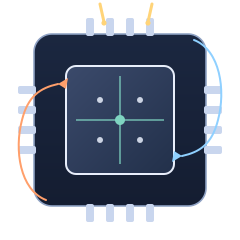
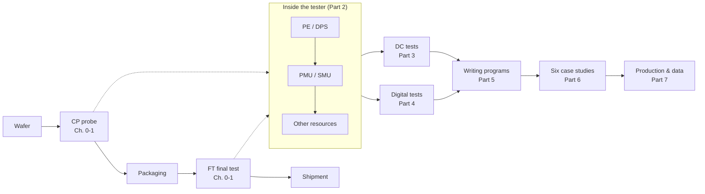

# Introduction to IC Testing Follow one chip through four exams, from wafer to shipment

🌐 **English** ｜ [简体中文](README.md) ｜ [Overview](../README.en.md) ｜ [Deep notes](../notes/) ｜ [AI skill entry](../SKILL.md)

---

> **Reader's note**：the 28-chapter body text is currently written in Simplified Chinese. This page gives the full table of contents in English with a one-line summary per chapter, so you can navigate the book and know what each chapter covers. Links below point to the Chinese chapter files.

## What this book is about

A chip is made — but does it work? You cannot tell by looking. You have to ask it with electricity.

The machine that asks is the **Automatic Test Equipment (ATE)**, usually just called the **tester**. It is one of the least visible yet most expensive links in the whole semiconductor chain: a machine can cost tens of millions, a single test item takes a few hundred microseconds, and a one-millivolt error in a limit can scrap a whole lot.

This book follows **one chip** — from the moment it is still on the wafer, through wafer probe (CP), packaging and final test (FT), to being binned as good and shipped. Along the way it opens up the tester and shows what resources are inside; it explains what DC parametric and digital functional test items actually measure; it writes a test program from scratch on a real training platform; and finally it walks through six different chips.

No formula derivations. Three things only:

- **Flow**: where a test starts, in what order it runs, when it is finished.
- **Terminology**: Chinese/English pairs, and how the words are actually said on the test floor.
- **Know-how**: what textbooks never mention but you meet on day one at the machine.

## Who it is for

- Undergraduates and graduate students in electronics, microelectronics and automation, currently taking an "IC Testing" course.
- New engineers on the test floor who want to understand what is inside the tester and why the program is written that way.
- Designers and process engineers who want to know what their chip goes through on a tester.

No semiconductor physics needed — basic circuit knowledge (voltage, current, resistance, MOS switches) is enough.

## Three helpers in every chapter

| Marker | Content |
|---|---|
| 📍 Journey position | Where this chapter sits in the journey, and what comes before/after |
| 📖 Terminology box | Definition, floor usage, related terms, and the most common confusion |
| 🔧 Know-how box | How it is done on site, and "why this way, what happens if you don't" |

---

## Book map

What a chip has to get through on a tester splits roughly into four layers: **can the hardware deliver the stimulus**, **can the test items measure accurately**, **does the program actually run**, **does the data tell a clear story**. Part 2 covers the first, Parts 3–4 the second, Parts 5–6 the third, Part 7 the fourth.

---

## Table of contents

### Part 0 — Before you start

| Chapter | What you'll read |
|---|---|
| [Ch. 0 — ATE in a nutshell: how many exams a chip must pass](0-before-you-start/00-ate-overview/README.md) | The CP and FT exams, the three kinds of equipment and their roles, how a test program comes to exist |
| [Ch. 1 — Inside the test floor: what a tester is made of](0-before-you-start/01-test-floor/README.md) | Boards in the rack, interface boards and DUT boards, the four entry points and roles, and the training platform used in this course |

### Part 1 — Fundamentals

| Chapter | What you'll read |
|---|---|
| [Ch. 2 — What is tested, what is judged: parameters, conditions, limits](1-fundamentals/02-what-is-tested/README.md) | DC vs AC, test conditions, min/max limits, guard band |
| [Ch. 3 — The skeleton of a test: flow, items and Bin](1-fundamentals/03-test-flow-and-bin/README.md) | Test flow, test item, bin classification, retest and datalog |

### Part 2 — Tester resources

| Chapter | What you'll read |
|---|---|
| [Ch. 4 — Pin electronics: drive and compare on every channel](2-instrumentation/04-pin-electronics/README.md) | Driver, comparator, active load, per-pin PMU |
| [Ch. 5 — DPS: power the chip and see how much it draws](2-instrumentation/05-dps/README.md) | Voltage/current ranges, four-wire connection, gang paralleling |
| [Ch. 6 — PMU and open/short test](2-instrumentation/06-pmu-and-os/README.md) | PPMU vs BPMU, diode clamping, why opens and shorts are obvious at a glance |
| [Ch. 7 — SMU: a source meter that works in four quadrants](2-instrumentation/07-smu/README.md) | Source and measure in one, four quadrants, compliance, Kelvin four-wire, how it differs from a PMU |
| [Ch. 8 — Other resources: relays, CBIT, TMU, AWG and DGT](2-instrumentation/08-other-resources/README.md) | How resources are routed to pins, clock and waveform resources, board self-test |

### Part 3 — DC parametric tests

| Chapter | What you'll read |
|---|---|
| [Ch. 9 — Leakage: IIL, IIH and IOZ](3-dc-tests/09-leakage/README.md) | Where input leakage comes from, why µA-level measurements need care |
| [Ch. 10 — Output drive: VOH, VOL, IOH and IOL](3-dc-tests/10-output-drive/README.md) | Output high/low levels, source and sink capability, load conditions |
| [Ch. 11 — Supply current: IDD and ICC](3-dc-tests/11-supply-current/README.md) | Static vs dynamic current, and why it is often the yield barometer |
| [Ch. 12 — Analog parameters: offset, gain, rejection ratios](3-dc-tests/12-analog-parameters/README.md) | VOS, AVD, CMRR, PSRR, and the key specs of op-amps and LDOs |

### Part 4 — Digital and functional tests

| Chapter | What you'll read |
|---|---|
| [Ch. 13 — Functional test: truth table, vectors and patterns](4-digital-tests/13-functional-test/README.md) | Turning a truth table into vectors, how a pattern file is written, how results are judged |
| [Ch. 14 — Timing and levels: timing, PinLevel and waveforms](4-digital-tests/14-timing-and-levels/README.md) | Period, edges, setup/hold time, drive and compare levels |
| [Ch. 15 — AC parameters: propagation delay, edges and Shmoo](4-digital-tests/15-ac-parameters/README.md) | tPD, tR/tF, maximum operating frequency, and finding boundaries with Shmoo plots |

### Part 5 — Writing test programs

| Chapter | What you'll read |
|---|---|
| [Ch. 16 — Project file system: what each of the seven files does](5-programming/16-project-files/README.md) | The roles and dependencies of `.job` `.tmf` `.sig` `.grp` `.res` `.tim` `.pat` |
| [Ch. 17 — Test.cpp: how user code gets called](5-programming/17-test-cpp/README.md) | DLL exports, lifecycle functions, `CheckResultAndBin`, exceptions and bins |
| [Ch. 18 — Seven measurement modes: what you force, what you measure](5-programming/18-measurement-modes/README.md) | What each mode forces, what it measures, and which clamp to configure |
| [Ch. 19 — Debugging: won't connect, doesn't take effect, doesn't match](5-programming/19-debugging/README.md) | Connection failures, stale DLLs, parameter-count mismatches, absurd readings |

### Part 6 — Six hands-on case studies

| Chapter | What you'll read |
|---|---|
| [Ch. 20 — Case 1: CD4511 BCD-to-7-segment decoder](6-case-studies/20-cd4511/README.md) | A pure digital device: open/short + leakage + output levels + truth table |
| [Ch. 21 — Case 2: HK24C02 EEPROM](6-case-studies/21-hk24c02/README.md) | Writing I²C timing into a pattern, page write and read-back |
| [Ch. 22 — Case 3: LM358 op-amp](6-case-studies/22-lm358/README.md) | Offset voltage, open-loop gain, CMRR and PSRR |
| [Ch. 23 — Case 4: TPS73625 LDO regulator](6-case-studies/23-tps73625/README.md) | Output accuracy, dropout voltage, quiescent current and enable control |
| [Ch. 24 — Case 5: HK32F031F4P6 MCU](6-case-studies/24-hk32f031/README.md) | Multiple power domains, reset and clock, running code before measuring |
| [Ch. 25 — Case 6: ADC0832 A/D converter](6-case-studies/25-adc0832/README.md) | ADC static and dynamic specs: DNL, INL, ENOB |

### Part 7 — Beyond the bench

| Chapter | What you'll read |
|---|---|
| [Ch. 26 — Yield, bins and data](7-beyond-the-bench/26-yield-and-data/README.md) | How yield is computed, bin Pareto, Cpk and correlation |
| [Ch. 27 — From the bench to the production line](7-beyond-the-bench/27-production-line/README.md) | Handlers, multi-site testing, test time and cost |

### Appendices

| Appendix | What you'll read |
|---|---|
| [Appendix A — Glossary](appendix/glossary.md) | Over a hundred terms with Chinese/English pairs and abbreviations |
| [Appendix B — Pitfall checklist](appendix/pitfalls.md) | Concrete failures you hit on the machine, and the order to troubleshoot them |
| [Appendix C — Further reading](appendix/further-reading.md) | Textbooks, standards, manuals and course resources |

---

## Reading paths

Reading in order is the most complete way; or pick a path that fits your need:

| Path | Suggested chapters |
|---|---|
| 🚀 Get the big picture first | Ch. 0, 1, 2, 3, 7 |
| 📏 Just want to know how DC parameters are measured | Ch. 2, 5, 6, 7 + Part 3 |
| 🔢 Digital device testing | Ch. 4, 13, 14, 15 + Ch. 20, 21 |
| 💻 Ready to write programs | Ch. 16–19 + any one case from Part 6 |
| 🏭 Preparing for a test-engineering internship | Read everything in order; focus on Part 2, Part 7 and Appendix B |

---

## How the book relates to the notes

The book is the **door**; the notes are the **material**.

Details mentioned at the end of each chapter — the full signature of an API, a line-by-line analysis of a project, an excerpt from a datasheet — are all in the repository's `notes/` directory, organized by the position of the original material. Follow the links when you want to dig deeper.

---

## Contributing

- **Found an error**: open an [Issue](https://github.com/wuyu25394-alt/sziit-speedcury-st2500-ate-skill/issues) with the chapter and the original text.
- **Want to add content**: read the [style guide](../STYLE_GUIDE.md) and [contribution guide](../CONTRIBUTING.md) first.
- The book is still growing — figures, examples, exercises and **English translations** are all welcome.

---

## Disclaimer

- Content is compiled from public material, general industry knowledge and course training materials; it contains no confidential information from any company.
- Model names (ST2500, ST2516, SMU20, etc.) are for illustration only; refer to the latest official documentation for specifications.
- Limit windows, delays and similar numbers vary with product and process; numbers in the book are examples only.

## License

The text is licensed under [Creative Commons Attribution-NonCommercial-ShareAlike 4.0 International](../LICENSE) (CC BY-NC-SA 4.0). You may freely copy and adapt it as long as you attribute the source, do not use it commercially, and share under the same license.
