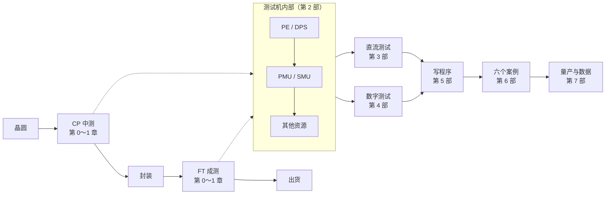

# 集成电路测试入门 跟着一颗芯片，走完从晶圆到出厂的四次考试

🌐 **简体中文** ｜ [总览首页](../README.md) ｜ [深度笔记库](../notes/) ｜ [AI 技能入口](../SKILL.md)

---

## 这本书在讲什么

一颗芯片做出来，能不能用？这个问题不能靠眼睛看，只能靠电去问它。

问它的那台机器叫**自动测试设备**（ATE），国内习惯叫「测试机」。它是整条产业链里最不显眼、却最贵的那一环之一：一台机器上千万，一个测试项几百微秒，判据差一个毫伏就可能让一批货报废。

这本书跟着**一颗芯片**，从晶圆还在片子上开始，经过中测、封装、成测，一直到它被判定合格、装箱出货。中间会拆开那台测试机，看里面有哪些资源；会讲清楚直流参数、数字功能这些测试项到底在测什么；会用一个真实的实训平台把程序从头写一遍；最后拿六颗不同的芯片各做一遍。

书里不推导公式，专注三件事：

- **流程**：一次测试从哪开始、按什么顺序走、什么时候算结束。
- **名词**：中英对照，以及在测试车间里实际怎么说这些词。
- **Know-how**：教科书不写、但上机第一天就会撞上的事。

## 适合谁读

- 电子、微电子、自动化专业的本科生与研究生，正在上「集成电路测试」这门课。
- 刚进测试岗的新人，想先弄明白测试机里到底有什么、程序为什么这么写。
- 做设计或工艺的人，想知道自己的芯片在测试机上经历了什么。

不需要半导体物理基础，懂一点电路（电压、电流、电阻、MOS 开关）就够。

## 每一章都有的三个小帮手

| 标示 | 内容 |
|---|---|
| 📍 测试旅程位置 | 这一章在整趟旅程的哪一站，前一站和下一站是什么 |
| 📖 名词框 | 定义、现场说法、相关名词，以及最容易搞混的地方 |
| 🔧 Know-how 框 | 现场怎么做，以及「为什么要这样做、没做会怎样」 |

例如第 7 章里的一个 Know-how 框：

> [!TIP]
> **🔧 Know-how｜选资源先问三件事**
>
> - **情境**：一个测试项要定下来用哪个资源，DPS、PPMU、BPMU、SMU 都能「给电」。
> - **做法**：按顺序问——要多少精度？要多大电流？要几路同时测？
> - **为什么**：精度决定选 SMU 还是别的；电流量程决定档位够不够；通道数决定能不能并测。
> - **没做会怎样**：用 DPS 测 μA 级漏电会被它 5 μA 的最小档卡住。

---

## 全书地图

一条芯片要在测试机上完成的事，可以粗分成四层：**硬件给不给得出激励**、**测试项测不测得准**、**程序跑不跑得通**、**数据说不说得清**。第 2 部解决第一层，第 3、4 部解决第二层，第 5、6 部解决第三层，第 7 部解决第四层。

---

## 目录

### 第 0 部　开始之前

| 章节 | 你会读到 |
|---|---|
| [第 0 章　ATE 全景：一颗芯片要过几道考场](0-before-you-start/00-ate-overview/README.md) | CP 与 FT 两次考试、三台设备的分工、测试程序是怎么被写出来的 |
| [第 1 章　走进测试车间：一台测试机由什么组成](0-before-you-start/01-test-floor/README.md) | 机柜里的板卡、接口板与 DUT 板、四种入口与角色，以及本课程的实训平台 |

### 第 1 部　基础

| 章节 | 你会读到 |
|---|---|
| [第 2 章　测什么、判什么：参数、条件与限值](1-fundamentals/02-what-is-tested/README.md) | 直流与交流、测试条件、最小值/最大值、guard band |
| [第 3 章　一次测试的骨架：流程、测试项与 Bin](1-fundamentals/03-test-flow-and-bin/README.md) | Test Flow、Test Item、Bin 分类、重测与 Datalog |

### 第 2 部　测试机的资源

| 章节 | 你会读到 |
|---|---|
| [第 4 章　引脚电子：每条通道的驱动与比较](2-instrumentation/04-pin-electronics/README.md) | Driver、Comparator、动态负载、每引脚的 PMU |
| [第 5 章　DPS：给芯片供电，顺便量出它吃多少](2-instrumentation/05-dps/README.md) | 器件电源的电压/电流档、四线接法、Gang 并联 |
| [第 6 章　PMU 与开短路测试](2-instrumentation/06-pmu-and-os/README.md) | PPMU 与 BPMU、二极管钳位、为什么开短路能一眼看出坏 |
| [第 7 章　SMU：一台能四象限工作的源表](2-instrumentation/07-smu/README.md) | 源测一体、四象限、Compliance、开尔文四线、与 PMU 的区别 |
| [第 8 章　其他资源：继电器、CBIT、TMU、AWG 与 DGT](2-instrumentation/08-other-resources/README.md) | 资源怎么被切换到引脚上、时钟与波形资源、板级自检 |

### 第 3 部　直流参数测试

| 章节 | 你会读到 |
|---|---|
| [第 9 章　漏电流：IIL、IIH 与 IOZ](3-dc-tests/09-leakage/README.md) | 输入漏电怎么来的、为什么 µA 级测量要特别小心 |
| [第 10 章　输出能力：VOH、VOL、IOH 与 IOL](3-dc-tests/10-output-drive/README.md) | 输出高低温、拉灌电流能力、负载条件 |
| [第 11 章　电源电流：IDD 与 ICC](3-dc-tests/11-supply-current/README.md) | 静态与动态电流、为什么它常是良率的晴雨表 |
| [第 12 章　模拟参数：失调、增益、抑制比](3-dc-tests/12-analog-parameters/README.md) | VOS、AVD、CMRR、PSRR，以及运放与 LDO 的关键指标 |

### 第 4 部　数字与功能测试

| 章节 | 你会读到 |
|---|---|
| [第 13 章　功能测试：真值表、向量与 Pattern](4-digital-tests/13-functional-test/README.md) | 把真值表变成向量、Pattern 文件怎么写、结果怎么判 |
| [第 14 章　时序与电平：Timing、PinLevel 与波形](4-digital-tests/14-timing-and-levels/README.md) | 周期、边沿、建立保持时间、驱动电平与比较电平 |
| [第 15 章　交流参数：传输延时、边沿与 Shmoo](4-digital-tests/15-ac-parameters/README.md) | tPD、tR/tF、最高工作频率，以及用 Shmoo 图找边界 |

### 第 5 部　写测试程序

| 章节 | 你会读到 |
|---|---|
| [第 16 章　工程文件体系：七种文件各管什么](5-programming/16-project-files/README.md) | `.job` `.tmf` `.sig` `.grp` `.res` `.tim` `.pat` 的分工与依赖 |
| [第 17 章　Test.cpp：用户代码怎么被调用](5-programming/17-test-cpp/README.md) | DLL 导出、生命周期函数、`CheckResultAndBin`、异常与 Bin |
| [第 18 章　七种测量模式：强制什么、测什么](5-programming/18-measurement-modes/README.md) | 每种模式强制什么、测什么、该配哪个钳位 |
| [第 19 章　调试与排错：连不上、不生效、对不上](5-programming/19-debugging/README.md) | 连接失败、DLL 不更新、参数个数不一致、读数离谱 |

### 第 6 部　六个实训案例

| 章节 | 你会读到 |
|---|---|
| [第 20 章　案例一：CD4511 数字译码器](6-case-studies/20-cd4511/README.md) | 纯数字器件：开短路 + 漏电 + 输出电平 + 真值表 |
| [第 21 章　案例二：HK24C02 存储器](6-case-studies/21-hk24c02/README.md) | I²C 时序怎么写进 Pattern、页写与读回 |
| [第 22 章　案例三：LM358 运算放大器](6-case-studies/22-lm358/README.md) | 失调电压、开环增益、共模与电源抑制比 |
| [第 23 章　案例四：TPS73625 线性稳压器](6-case-studies/23-tps73625/README.md) | 输出电压精度、压差、静态电流与使能控制 |
| [第 24 章　案例五：HK32F031F4P6 单片机](6-case-studies/24-hk32f031/README.md) | 多电源域、复位与时钟、跑一段程序再测 |
| [第 25 章　案例六：ADC0832 模数转换器](6-case-studies/25-adc0832/README.md) | ADC 的静态与动态指标：DNL、INL、ENOB |

### 第 7 部　走出实训台

| 章节 | 你会读到 |
|---|---|
| [第 26 章　良率、Bin 与数据](7-beyond-the-bench/26-yield-and-data/README.md) | 良率怎么算、Bin 帕累托、Cpk 与相关性比对 |
| [第 27 章　从实训台到量产线](7-beyond-the-bench/27-production-line/README.md) | Handler、多工位并测、测试时间与成本 |

### 附录

| 附录 | 你会读到 |
|---|---|
| [附录 A　术语总表](appendix/glossary.md) | 一百多个术语的中英对照与缩写，也是全书用词的依据 |
| [附录 B　现场踩坑清单](appendix/pitfalls.md) | 上机时会撞上的具体故障与排查顺序 |
| [附录 C　延伸阅读](appendix/further-reading.md) | 教材、标准、手册与课程资源 |

---

## 阅读路线

依序阅读是最完整的方式，也可以按自己的需要挑一条路：

| 路线 | 建议章节 |
|---|---|
| 🚀 先建立全貌 | 第 0、1、2、3、7 章 |
| 📏 只想搞懂直流参数怎么测 | 第 2、5、6、7 章 + 第 3 部 |
| 🔢 数字器件测试 | 第 4、13、14、15 章 + 第 20、21 章 |
| 💻 要动手写程序 | 第 16～19 章 + 第 6 部任选一个案例 |
| 🏭 准备去测试岗实习 | 依序读完全书，重点第 2 部、第 7 部与附录 B |

---

## 这本书和笔记库的关系

书是**入口**，笔记是**资料**。

各章末尾提到的细节——某个 API 的完整签名、某个工程的逐行分析、某款芯片数据手册的摘录——都在仓库的 `notes/` 目录里，按原始资料的位置组织。想深挖的时候顺着链接走过去就行。

---

## 参与这个项目

- **发现错误**：到 [Issues](https://github.com/wuyu25394-alt/sziit-speedcury-st2500-ate-skill/issues) 提一条，写清楚章节和原文。
- **补充内容**：先读[写作规范](../STYLE_GUIDE.md)与[贡献指南](../CONTRIBUTING.md)。
- 这本书还在长，缺图、缺例子、缺练习题的地方都欢迎补。

---

## 免责声明

- 本书内容整理自公开资料、行业通用知识与课程培训材料，不含任何公司的机密信息。
- 书中涉及的具体型号（ST2500、ST2516、SMU20 等）仅用于说明，规格数值以官方最新文档为准。
- 判据窗口、延时等具体数值随产品与工艺而变，书中的数字只作示例。

## 授权

本书文字采用 [知识共享 署名—非商业性使用—相同方式共享 4.0 国际](../LICENSE)（CC BY-NC-SA 4.0）授权。注明出处、不用于商业目的、以相同方式分享，即可自由转载与改编。
